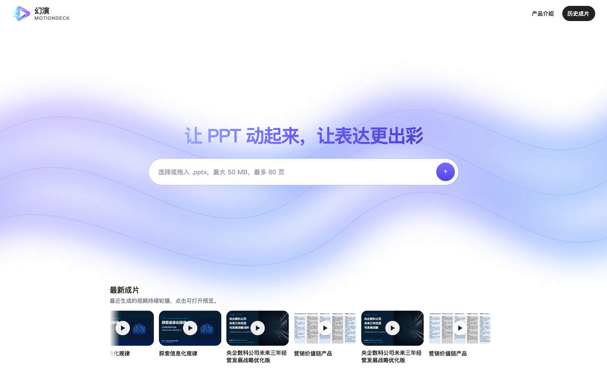
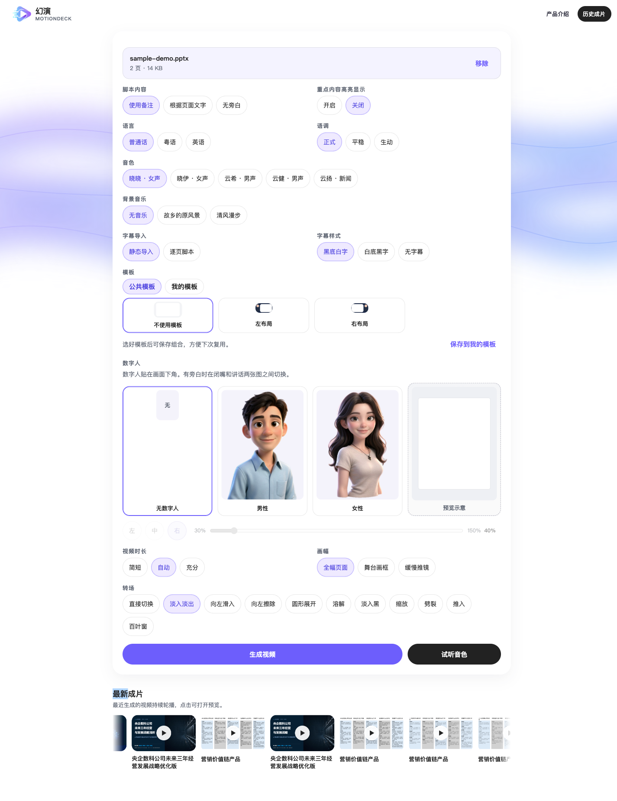

# 幻演 · MotionDeck

[](LICENSE)
[](#系统要求)
[](package.json)

上传一份 PPT，几分钟后拿走一支可分享的讲解视频。

不剪辑、不配音棚——把已有的演示文稿，变成带旁白、字幕、转场与数字人的成片。

适合培训讲解、产品介绍、课程录制等「有 PPT、要讲清楚」的场景。

---

## 界面预览

| 创作 · 上传 | 创作 · 配置 | 历史成片 |
| --- | --- | --- |
|  |  |  |

---

## 功能特性

- **PPT → 视频**：上传 `.pptx`，按页序导出画面，输出 1920×1080 MP4
- **旁白三种来源**：演讲者备注 / 页面文字 / 无旁白；支持逐页改脚本后再生成
- **多语言音色**：普通话、粤语、英语；可调语调与时长，生成前可试听
- **画面与转场**：全幅 / 舞台画框 / 缓慢推镜；十余种页间转场
- **模板与数字人**：公共模板 + 本地半身肖像，位置与缩放可调，随音量切换口型
- **字幕与重点高亮**：语音同步字幕；可选给讲到的文字形状描框
- **背景音乐**：可选轻柔垫底，不盖过旁白
- **历史成片**：本地归档，重启后仍可预览与下载

---

## 系统要求

| 依赖 | 说明 |
| --- | --- |
| **macOS** | 当前仅支持 macOS（PowerPoint + Swift 原生工具） |
| **Node.js** | 20+ |
| **Microsoft PowerPoint** | 用于将演示文稿导出为 PDF |
| **ffmpeg / ffprobe** | 需在 `PATH` 中，用于音视频拼接 |
| **网络** | 语音合成调用微软 Edge 在线朗读（无需 API Key） |

Xcode Command Line Tools / 系统自带 Swift 即可；首次生成时会编译 `native/*.swift` 辅助程序。

---

## 快速开始

```bash
# 1. 克隆
git clone https://github.com/yangchchi/ppt_video.git
cd ppt_video

# 2. 安装依赖
npm install

# 3. 启动（默认 http://127.0.0.1:3780）
npm run dev
```

浏览器打开上述地址，拖入 `.pptx`（最大 50 MB，最多 80 页），配置后点击「生成视频」。

生产模式：

```bash
npm run build
npm start
```

运行测试：

```bash
npm test
```

---

## 配置项

通过环境变量调整（均可选）：

| 变量 | 默认值 | 说明 |
| --- | --- | --- |
| `PORT` | `3780` | HTTP 端口 |
| `TTS_VOICE` | `zh-CN-XiaoxiaoNeural` | 默认音色（须在可选列表内） |
| `EMPTY_SLIDE_SECONDS` | `3` | 「自动」时长下空脚本页停留秒数 |
| `MAX_UPLOAD_MB` | `50` | 上传大小上限（MB） |
| `MAX_SLIDES` | `80` | 最大页数 |

示例：

```bash
PORT=4000 MAX_UPLOAD_MB=100 npm run dev
```

---

## 使用流程

1. 选择或拖入 `.pptx`
2. 配置脚本来源、语言音色、画幅转场、模板与数字人等
3. 点击生成，等待：校验 → 导出画面 → 合成语音 → 拼接视频
4. 预览、下载 MP4；之后可在「历史成片」中找回

同一时间只渲染一个任务。配置稿（draft）不占用渲染队列。

---

## 技术概览

单进程 Node 服务：网页 + 转换流水线。

```
上传 .pptx
  → 解包备注 / 页面文字（配置稿）
  → PowerPoint 导出 PDF → Swift 渲染 PNG
  → Edge TTS 合成旁白
  → ffmpeg 烧字幕、画幅、转场、数字人 → MP4
```

主要目录：

```
src/           HTTP、任务队列、流水线
native/        Swift 辅助（PDF 渲染、字幕、数字人）
public/        前端页面
assets/        数字人源图等静态资源
test/          单元测试
data/          运行时产物（已 gitignore，勿提交）
```

更细的规格见 [`.docs/func_spec.md`](.docs/func_spec.md)、[`.docs/tech_spec.md`](.docs/tech_spec.md)。

---

## 限制与说明

- 仅支持 `.pptx`，不支持旧版 `.ppt`、Keynote、PDF 直接上传
- 不还原 PowerPoint 动画、嵌入视频或自动播放音频；导出为静态页面
- 数字人为本地轻量肖像切换，非云端口型驱动
- 不调用外部大模型改写脚本；不提供多用户 / 云存储 / 积分体系
- 当前为 **本机单人工具**，默认只监听 `127.0.0.1`

---

## 贡献

欢迎 Issue 与 Pull Request。提交前建议：

```bash
npm test
```

较大改动请先开 Issue 说明动机与方案。

---

## 许可证

本项目采用 [MIT License](LICENSE)。

---

把静态幻灯片，变成听得见、看得进的讲述。**幻演，让 PPT 动起来。**
